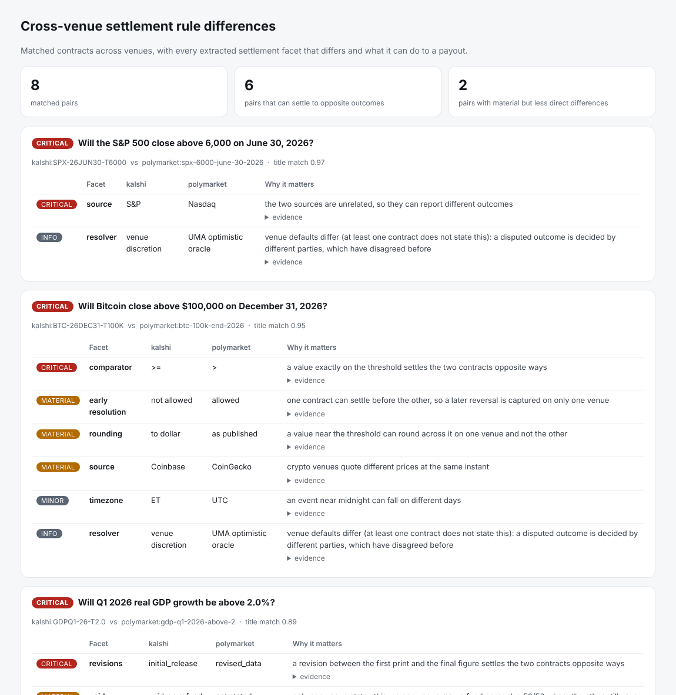

# contract-rules-diff

Two prediction markets can ask what looks like the same question and pay out
differently. This tool matches equivalent contracts across venues, extracts
the settlement rules that decide a payout, and reports every difference with
a judgment about what it can do to the outcome.



> Independent project. Not affiliated with or endorsed by River Markets,
> Kalshi or Polymarket. The bundled contracts are synthetic: the rules text is
> written for this project to exercise the extractor and imitates house style,
> but is not copied from and does not represent any real listed contract. Live
> adapters for both venues are included and unit-tested against recorded
> payloads.

## Why this, for River

River already routes orders across venues and maps contracts to a single
`river_id`, so a trader sees one book. That mapping carries an assumption: the
contracts on each side are the same bet. Usually they are. When they are not,
the trader is not arbitraging, they are holding an unhedged position they
believe is flat. The differences that cause it are small and easy to skim
past:

- Kalshi settles CPI from the **initial release and ignores revisions**;
  Polymarket's description says the **value available at settlement**. A
  revision between them settles the two contracts opposite ways.
- One contract says **at least $100,000**, the other says **above $100,000**.
  At exactly $100,000 they pay opposite sides.
- A hurricane-count market counts storms **as of December 15**; the other
  counts **as of January 31**, after post-season reanalysis, which has added
  storms before.
- One venue permits **early resolution**; the other settles only at
  expiration, so a later reversal is captured on one side only.

A rules diff is the natural companion to the contract mapping: it tells a
trader which of their "matched" pairs are safe to treat as one instrument,
and which carry a tail that only shows up on settlement day.

## What it produces

```
$ rulesdiff report --min-severity material

8 matched pairs: 6 with critical differences, 2 material, 0 equivalent for practical purposes.

Will May 2026 nonfarm payrolls exceed 150,000?
  kalshi:NFP-26MAY-T150  vs  polymarket:nfp-may-2026-above-150k   (title match 0.87)
  [critical] revisions: initial_release vs revised_data - a revision between the first print and the final figure settles the two contracts opposite ways
  [material] tie_handling: exact value resolves no vs not stated - only one venue states this, so an exact tie on the threshold is handled differently
  [info] resolver: venue discretion vs UMA optimistic oracle - venue defaults differ

Will there be at least 14 named Atlantic storms in the 2026 season?
  kalshi:HURR-26-NAMED-T14  vs  polymarket:atlantic-named-storms-2026-14   (title match 0.78)
  [critical] deadline: December 15 2026 vs January 31 2027 - an event occurring between the two deadlines settles the contracts opposite ways
```

`--html` writes the report shown in the screenshot, where every row expands to
the sentence each value was read from.

## How it works

```
rulesdiff/
  model.py     Contracts, extracted facets, differences, severities
  sources.py   Sample loader plus Kalshi and Polymarket adapters (parsers separated from fetching)
  match.py     Cross-venue contract matching
  extract.py   Rule parsing: sources, thresholds, comparators, revisions, rounding,
               timezones, deadlines, windows, early resolution, voids, ties, resolver
  diff.py      Facet comparison and severity assignment
  report.py    Text and HTML reports
  cli.py       report / pair / facets / live
```

### Matching

Character-trigram cosine similarity over normalized titles handles different
house styles ("Will CPI be above 3.0% in March 2026?" versus "CPI above 3% in
March 2026?"). On top of that, **anchor tokens are a hard gate**: quantities,
months and years that appear on both sides must agree, so a 3% contract never
matches a 4% contract and a March contract never matches an April one. Those
are exactly the pairs a human skims past, and a similarity score alone ranks
them near the top. Matching is greedy and one-to-one.

### Extraction

Rule-based rather than a language model, for three reasons: every extraction
carries the sentence it came from, so a trader can check it; the output is
identical across runs, so a diff against yesterday shows real rule changes
rather than sampling noise; and it is cheap enough to re-run over every
contract on both venues whenever a description is edited. Where a pattern does
not fire, the facet is reported as "not stated" rather than guessed.

Two details that took iteration:

- **Settlement source versus subject.** The rules text usually names the thing
  being bet on ("the S&P 500 closes above 6,000") even when a different
  organization publishes the settling number. When a venue exposes a
  settlement-source field, that field wins over a scan of the rules.
- **Venue defaults.** Kalshi resolves disputes at the exchange's discretion;
  Polymarket uses the UMA optimistic oracle. That is true of nearly every pair,
  so when at least one side's value comes from a venue default rather than the
  contract text, it is reported as informational and kept out of the critical
  count, where it would otherwise drown the real findings.

### Severity

Assigned from what a difference can do to a payout, not from how different the
words are:

| Severity | Meaning | Examples |
| --- | --- | --- |
| critical | A realistic outcome pays YES on one venue and NO on the other | different thresholds, comparators at the boundary, initial release versus revised data, different measurement cutoffs |
| material | Settlement can differ in plausible cases | unrelated-but-correlated sources, rounding, early resolution, one venue silent on ties or voids |
| minor | Affects timing or wording, rarely the outcome | timezone wording, a fallback source added on one side |
| info | Structural venue difference, stated by neither contract | default dispute resolver |

Sources get a second look: BLS and FRED publish the same series, so a
BLS-versus-FRED difference is material (FRED carries revisions, the BLS
release does not) rather than critical, while S&P versus Nasdaq is treated as
unrelated. Those equivalences live in one table in `diff.py`.

## Running it

Requires Python 3.11 or newer. No third-party dependencies.

```bash
python -m venv .venv && source .venv/bin/activate
pip install -e ".[dev]"

rulesdiff report --html out/report.html
rulesdiff report --min-severity critical
rulesdiff pair data/sample_contracts.json kalshi:NFP-26MAY-T150 polymarket:nfp-may-2026-above-150k
rulesdiff facets data/sample_contracts.json kalshi:CPIYOY-26MAR-T3.0
pytest
```

`rulesdiff facets` prints every extraction with its evidence, which is the
first thing to look at when a diff seems wrong.

### Against live venues

```bash
rulesdiff live --limit 200 --html out/live.html
```

This calls Kalshi's public `/markets` endpoint and Polymarket's Gamma
`/markets` endpoint. No credentials are needed for either. The parsers
(`parse_kalshi`, `parse_polymarket`) are separate from the fetch calls and are
tested against recorded payloads, so the extraction and diff logic is
exercised in CI without network access.

## Tests

33 tests covering sentence splitting with abbreviations, number
normalization (percent, dollars, basis points, scale words), each extraction
pattern, the rule that every extraction carries its evidence, the stated-source
override, matching across house styles, anchor rejection of mismatched numbers
and months, one-to-one matching, unmatched contracts being left alone, each
severity rule, identical rules producing no differences, both venue parsers
including missing fields, and the CLI.

## Limitations and next steps

- Extraction is pattern-based, so unusual phrasing is missed rather than
  mis-read. The honest way to measure this is a labelled set of real
  contracts; the confidence field and the evidence trail exist so a human
  review loop can produce one.
- Matching is title-based. River's own `river_id` mapping would replace it,
  and this tool would become the check on that mapping rather than a
  competitor to it.
- Several facets are detected but not yet quantified. The natural next step is
  to attach a probability to each critical difference (how often does CPI get
  revised across a 0.1 boundary?), which turns a list of warnings into an
  expected cost per pair.

## License

MIT
